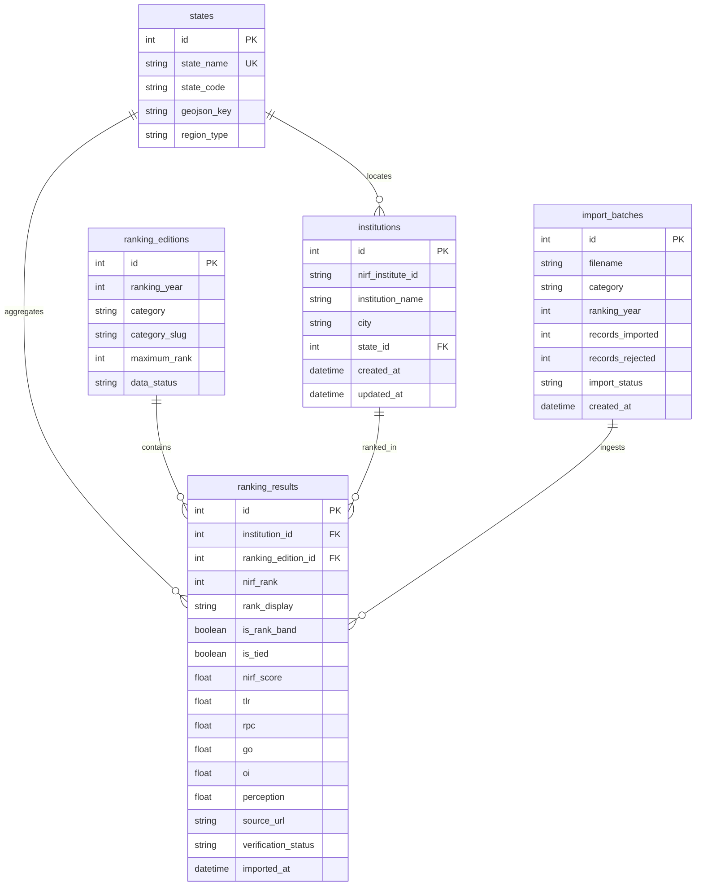

# NIRF INSIGHT: RELATIONAL DATABASE SCHEMA SPECIFICATION

**Project:** NIRF Insight – India State-wise Ranking Distribution Dashboard  
**Management:** ICARE under the MITRA Project  
**Target Database:** PostgreSQL 13+ (with dual-engine SQLite support for local environments)  

---

## 1. Entity-Relationship Architecture

---

## 2. Table Specifications

### 2.1 `states`
Contains the 36 canonical Indian States and Union Territories matching official Survey of India boundary keys:
* `id`: Primary Key (Serial / Integer)
* `state_name`: Official State Name (`VARCHAR(100)`, Unique)
* `state_code`: Two-letter Postal/ISO code (e.g. `MH`, `TN`, `DL`)
* `geojson_key`: Geographic key matching `india_states.geojson` property `ST_NM`
* `region_type`: Classification (`State` or `Union Territory`)

### 2.2 `institutions`
Normalized registry of educational institutions across India:
* `id`: Primary Key (Serial / Integer)
* `nirf_institute_id`: Official Ministry identifier (`VARCHAR(50)`, e.g. `IR-O-U-0456`)
* `institution_name`: Canonical institution title (`VARCHAR(255)`)
* `city`: City / Municipal corporation (`VARCHAR(100)`)
* `state_id`: Foreign Key referencing `states.id`
* Constraints: Unique composite constraint on `(institution_name, state_id)`

### 2.3 `ranking_editions`
Represents an annual ranking release for a specific NIRF category:
* `id`: Primary Key (Serial / Integer)
* `ranking_year`: Evaluation cycle year (`INTEGER`, e.g. 2023, 2024, 2025)
* `category`: Official category title (`VARCHAR(100)`)
* `category_slug`: URL and API identifier (`VARCHAR(100)`)
* `maximum_rank`: Published rank ceiling (e.g. 200, 300, 100, 50)
* `data_status`: Verification state (`verified`, `not_available`, `pending`)

### 2.4 `ranking_results`
Fact table recording individual ranking entries and parameter scorecards:
* `id`: Primary Key (Serial / Integer)
* `institution_id`: Foreign Key referencing `institutions.id`
* `ranking_edition_id`: Foreign Key referencing `ranking_editions.id`
* `nirf_rank`: Numeric rank integer (Null for rank-banded institutions)
* `rank_display`: Text representation (`1`, `2`, `101-150`, `151-200`)
* `is_rank_band`: Boolean flag distinguishing individual ranks from rank bands
* `is_tied`: Boolean flag indicating identical tied rankings
* `nirf_score`: Overall composite score out of 100
* `tlr`: Teaching, Learning & Resources metric (Scale: 100)
* `rpc`: Research and Professional Practice metric (Scale: 100)
* `go`: Graduation Outcomes metric (Scale: 100)
* `oi`: Outreach and Inclusivity metric (Scale: 100)
* `perception`: Peer Perception metric (Scale: 100)
* `source_url`: URL to official NIRF Data Capturing System (DCS) PDF report
* `verification_status`: Record verification state (`verified`, `flagged`)

### 2.5 `import_batches`
Audit logging table for dataset ingestion runs:
* `id`: Primary Key (Serial / Integer)
* `filename`: Source spreadsheet filename
* `category`: Target ranking category
* `ranking_year`: Target ranking year
* `records_imported`: Count of successfully inserted records
* `records_rejected`: Count of invalid or excluded records
* `import_status`: Execution state (`completed`, `failed`)
* `created_at`: Ingestion timestamp
